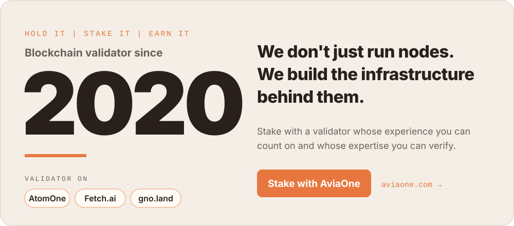
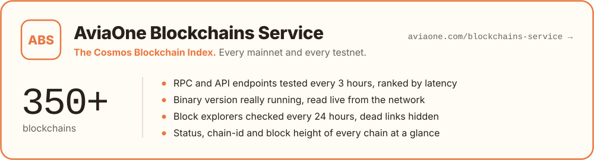
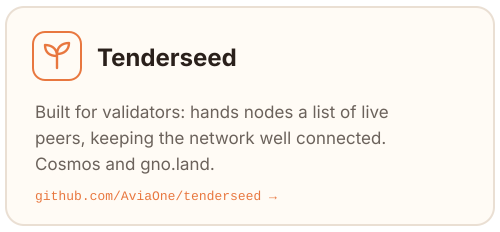
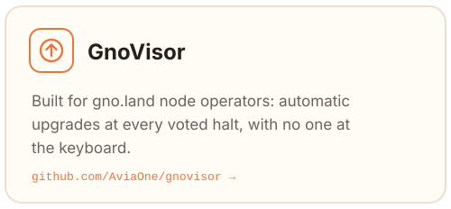
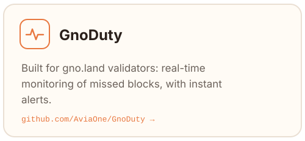
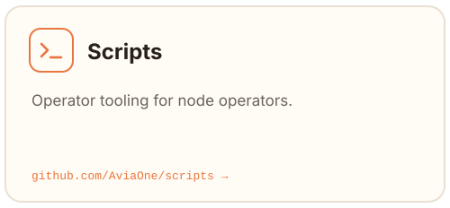
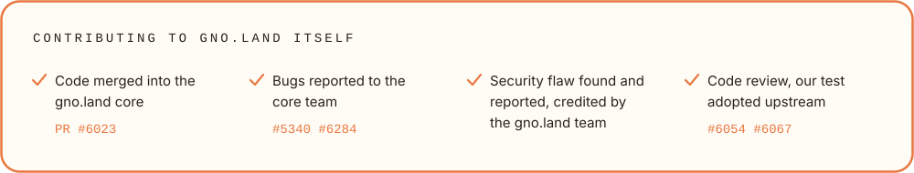
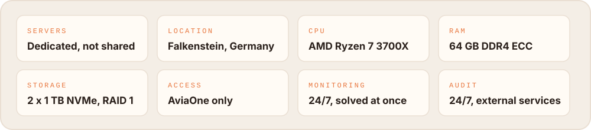

  

  

  
  
  
  

  
   
  <a href="https://github.com/gnolang/gno/pull/6023">PR #6023</a> · <a href="https://github.com/gnolang/gno/issues/5340">#5340</a> · <a href="https://github.com/gnolang/gno/issues/6284">#6284</a> · <a href="https://github.com/gnolang/gno/pull/6054">#6054</a> · <a href="https://github.com/gnolang/gno/pull/6067">#6067</a>

  

<b>AviaOne Blockchains Service (ABS), a permanent contribution to the whole ecosystem</b>

 

[**ABS (AviaOne BlockChains Service)**](https://aviaone.com/blockchains-service/) is our longest running contribution, and the one that never stops: it is maintained every single day. It turns the raw data of the Cosmos Chain Registry into a living dashboard covering **more than 350 blockchains**, mainnet and testnet alike.

- **Verified RPC and API endpoints**, tested every 3 hours and sorted by latency, so you never copy a dead endpoint again
- **Binary version detection**: the version actually running on the network, compared against what the registry claims
- **Block explorers checked every 24 hours**, dead links are hidden instead of being served
- **Live network status**: block height, chain IDs, health
- Seeds, peers and installation guides for every listed chain
- Automatic synchronisation with `cosmos/chain-registry`

Nobody pays for it and nothing is gated. It exists because validators, developers and node operators need data that is true today, not data that was true when a registry entry was last edited.

<b>Tenderseed, back in maintenance</b>

 

Seed nodes are the front door of every Cosmos chain, and the reference implementation had been left unmaintained for more than three years. We took it over. [**AviaOne/tenderseed**](https://github.com/AviaOne/tenderseed) is maintained and released regularly, under the original Blue Oak licence. [Latest release](https://github.com/AviaOne/tenderseed/releases/latest).

- ported to **CometBFT v0.40.x**, down to 30 compiled dependencies
- **address verification**: every address served to a peer is dialled and qualified first, so the address book stops handing out dead endpoints
- exposed settings that were hardcoded upstream, including `seed_disconnect_wait_period`, which silently kept every address book almost empty in the original binary and in all of its forks
- Prometheus metrics, unit tests, CI, release archives and multi-arch images on `ghcr.io/aviaone/tenderseed`
- no panics left, existing installations upgrade without touching `node_key.json`

Credit where it is due: [BitCannaGlobal](https://github.com/BitCannaGlobal/tenderseed) for the earlier port attempt, and [cosmoseed](https://github.com/voluzi/cosmoseed) for the composed reactor design.

<b>GnoVisor, upgrades on gno.land with no one at the keyboard</b>

 

Cosmovisor does not work on gno.land: no `upgrade-info.json` is written, a live node stays alive at a halt instead of exiting, and a version is a binary plus its `GNOROOT`. [**AviaOne/gnovisor**](https://github.com/AviaOne/gnovisor) fills that gap.

- watches the chain for a halt programmed by a GovDAO vote
- prepares the new binary and its `GNOROOT` ahead of the halt, checked against the gno.land upgrade ledger
- at the halt: stops the node, backs it up, switches to the new version and starts it again
- never goes back to the old version after a halt
- runs the node from a binary or in Docker, from the official image of each version
- written from scratch in Go, no dependency outside the standard library, AGPL-3.0

 

  
  
  
  
  
  

  <a href="https://aviaone.com/blog/2024-has-been-a-challenging-year/">Why we shut down 12 mainnet nodes at the end of 2024</a>
    
  

